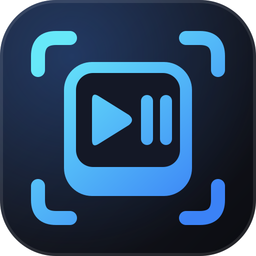

<div align="center">



# YouTube Media Keys Fix

**Keeps the play and pause keys pointed at the YouTube video you are watching.**<br>
Fixes the keys that go dead after you queue a video or use the miniplayer. A Chrome and Brave extension.

[](LICENSE)
[](https://github.com/obrenoalvim/youtube-media-keys-fix/stargazers)
[](manifest.json)
[](#install)

**English** · [Português](README.pt-BR.md)

[The problem](#the-problem) · [Install](#install) · [How it works](#how-it-works) · [Limits](#limits) · [Tests](#tests) · [FAQ](#faq)

</div>

---

A tiny Manifest V3 extension. It adds no button and no popup. You install it once and the play and pause keys of your keyboard, headset and Windows media overlay keep working on YouTube.

## The problem

You are watching a video. You press `i` to shrink it into the miniplayer, queue a few more videos and go back. Now the play/pause key does nothing, and so does the media overlay. The only way out is to click pause on the page. It works again after a new video starts.

When this was traced on Windows, the media session of the browser had drifted from the page: it named a video you only queued as the active one, and it kept reporting "playing" after the real video was paused. A key press was sent to a player that was not the one on screen.

## Install

1. Go to `chrome://extensions` (or `brave://extensions`)
2. Enable **Developer mode**
3. **Load unpacked** and select this folder
4. Reload any open YouTube tab (F5)

That is all. Nothing to configure.

## How it works

The extension runs a small script inside `youtube.com`, before the page code.

- It wraps `MediaSession.setActionHandler`. When YouTube registers its own `play` and `pause` handlers, the extension swaps in handlers that act on the main player (`#movie_player`), so a hover preview or a queued video cannot take the keys.
- It sets `playbackState` from what the main player is really doing, and refreshes it on `play`, `pause`, `playing`, `emptied`, `ended` and on every YouTube page change. No timers, no polling.
- On pages with no main player, such as Shorts, it hands the key back to the handler YouTube registered.

It needs no permission. The only thing in the manifest is a content script for `https://www.youtube.com/*`.

## Limits

- Tested on Brave. Chrome, Edge and other Chromium browsers run the same code, but I have not tried them.
- It fixes the keys and the playing or paused state. The title that Windows shows in its media overlay can still name the wrong video.
- Only `youtube.com`. YouTube Music and embedded players are not covered.
- It is not on the Chrome Web Store. Install it unpacked, as shown above.

## Tests

```bash
npm test
```

The tests load `fix.js` against a fake media session and check that the keys reach the main player, that the page handler is used when there is no player, and that the playback state follows the real video. They need Node 20 or newer and no dependencies.

---

## FAQ

**Does it collect any data?**
No. It has no permissions, makes no network request and stores nothing.

**Why does the key stop working in the first place?**
The browser publishes one media session per tab and decides which player it points to. YouTube changes players when you queue a video, hover a preview or use the miniplayer, and the session can be left pointing at the wrong one. The extension does not change that. It makes sure play and pause reach the right player anyway.

**Will it break the other keys?**
No. Next and previous keep the handlers YouTube registers. Only `play` and `pause` are replaced.

**Can I use it with a hardware media key or a headset?**
Yes. Those keys arrive through the same browser media session.

## More tools by the same author

- [**media-harvest**](https://github.com/obrenoalvim/media-harvest): a DevTools panel that captures every image and video a page loads.
- [**youtube-live-analyzer**](https://github.com/obrenoalvim/youtube-live-analyzer): a Chrome extension that ranks the topics people discuss in a YouTube live chat.
- [**windock**](https://github.com/obrenoalvim/windock): a dock for Windows that swaps your apps by environment and can replace the taskbar.

## Contributing

Bug or idea? Open an issue or a PR. See [CONTRIBUTING.md](CONTRIBUTING.md) and the [changelog](CHANGELOG.md).

## License

[MIT](LICENSE)

---

<div align="center">

If the play key stopped betraying you, a ⭐ helps other people find it.

<sub>**Topics:** chrome-extension · brave-extension · youtube · media-session · media-keys · manifest-v3 · keyboard-shortcuts · vanilla-js</sub>

</div>
