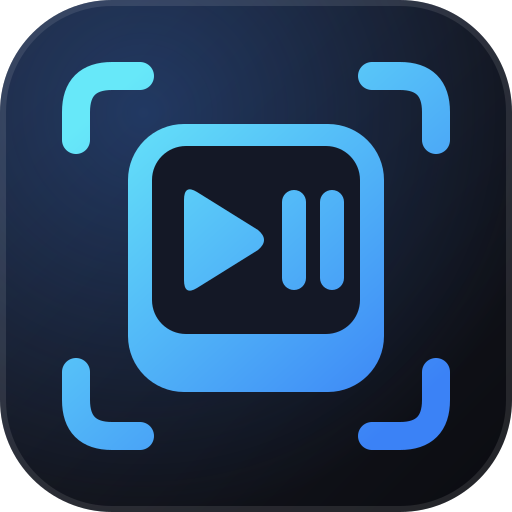

<div align="center">



# YouTube Media Keys Fix

**Mantém as teclas de play e pause apontadas para o vídeo do YouTube que você está assistindo.**<br>
Conserta as teclas que morrem depois de você pôr um vídeo na fila ou usar o miniplayer. Uma extensão para Chrome e Brave.

[](LICENSE)
[](https://github.com/obrenoalvim/youtube-media-keys-fix/stargazers)
[](manifest.json)
[](#instalar)

[English](README.md) · **Português**

[O problema](#o-problema) · [Instalar](#instalar) · [Como funciona](#como-funciona) · [Limites](#limites) · [Testes](#testes) · [Perguntas frequentes](#perguntas-frequentes)

</div>

---

Uma extensão Manifest V3 minúscula. Não adiciona botão nem popup. Você instala uma vez e as teclas de play e pause do teclado, do fone e da sobreposição de mídia do Windows continuam funcionando no YouTube.

## O problema

Você está vendo um vídeo. Aperta `i` para encolher no miniplayer, põe mais alguns vídeos na fila e volta. Agora a tecla play/pause não faz nada, e a sobreposição de mídia também não. A única saída é clicar em pause na página. Volta a funcionar quando começa outro vídeo.

Quando isso foi investigado no Windows, a sessão de mídia do navegador tinha se afastado da página: ela apontava como ativo um vídeo que você só tinha enfileirado, e continuava dizendo "tocando" depois que o vídeo real foi pausado. A tecla ia para um player que não era o da tela.

## Instalar

1. Vá em `chrome://extensions` (ou `brave://extensions`)
2. Ative o **Modo do desenvolvedor**
3. Clique em **Carregar sem compactação** e selecione esta pasta
4. Recarregue as abas do YouTube que estiverem abertas (F5)

Pronto. Não tem nada para configurar.

## Como funciona

A extensão roda um script pequeno dentro do `youtube.com`, antes do código da página.

- Ela envolve o `MediaSession.setActionHandler`. Quando o YouTube registra os próprios handlers de `play` e `pause`, a extensão troca por handlers que agem no player principal (`#movie_player`), então uma prévia ao passar o mouse ou um vídeo da fila não conseguem pegar as teclas.
- Ela define o `playbackState` a partir do que o player principal está realmente fazendo, e atualiza em `play`, `pause`, `playing`, `emptied`, `ended` e a cada troca de página do YouTube. Sem timers, sem polling.
- Em páginas sem player principal, como o Shorts, ela devolve a tecla para o handler que o YouTube registrou.

Não pede nenhuma permissão. A única coisa no manifest é um content script para `https://www.youtube.com/*`.

## Limites

- Testada no Brave. Chrome, Edge e outros navegadores Chromium rodam o mesmo código, mas eu não testei.
- Ela conserta as teclas e o estado tocando ou pausado. O título que o Windows mostra na sobreposição de mídia ainda pode citar o vídeo errado.
- Só `youtube.com`. YouTube Music e players incorporados não são cobertos.
- Não está na Chrome Web Store. Instale sem compactação, como mostrado acima.

## Testes

```bash
npm test
```

Os testes carregam o `fix.js` contra uma sessão de mídia falsa e conferem que as teclas chegam ao player principal, que o handler da página é usado quando não há player, e que o estado de reprodução acompanha o vídeo real. Precisam do Node 20 ou mais novo e de nenhuma dependência.

---

## Perguntas frequentes

**Coleta algum dado?**
Não. Não tem permissões, não faz requisição de rede e não guarda nada.

**Por que a tecla para de funcionar, para começo de conversa?**
O navegador publica uma sessão de mídia por aba e decide para qual player ela aponta. O YouTube troca de player quando você enfileira um vídeo, passa o mouse numa prévia ou usa o miniplayer, e a sessão pode ficar apontando para o errado. A extensão não muda isso. Ela garante que play e pause cheguem ao player certo mesmo assim.

**Quebra as outras teclas?**
Não. Próximo e anterior mantêm os handlers que o YouTube registra. Só `play` e `pause` são trocados.

**Funciona com tecla de mídia do teclado ou fone?**
Funciona. Essas teclas chegam pela mesma sessão de mídia do navegador.

## Mais ferramentas do mesmo autor

- [**media-harvest**](https://github.com/obrenoalvim/media-harvest): painel do DevTools que captura toda imagem e vídeo que uma página carrega.
- [**youtube-live-analyzer**](https://github.com/obrenoalvim/youtube-live-analyzer): extensão para Chrome que ranqueia os assuntos discutidos no chat de uma live do YouTube.
- [**windock**](https://github.com/obrenoalvim/windock): dock para Windows que troca seus apps por ambiente e pode substituir a barra de tarefas.

## Contribuindo

Bug ou ideia? Abra uma issue ou um PR. Veja o [CONTRIBUTING.pt-BR.md](CONTRIBUTING.pt-BR.md) e o [changelog](CHANGELOG.md).

## Licença

[MIT](LICENSE)

---

<div align="center">

Se a tecla de play parou de te trair, uma ⭐ ajuda outras pessoas a encontrá-la.

<sub>**Tópicos:** chrome-extension · brave-extension · youtube · media-session · media-keys · manifest-v3 · keyboard-shortcuts · vanilla-js</sub>

</div>
